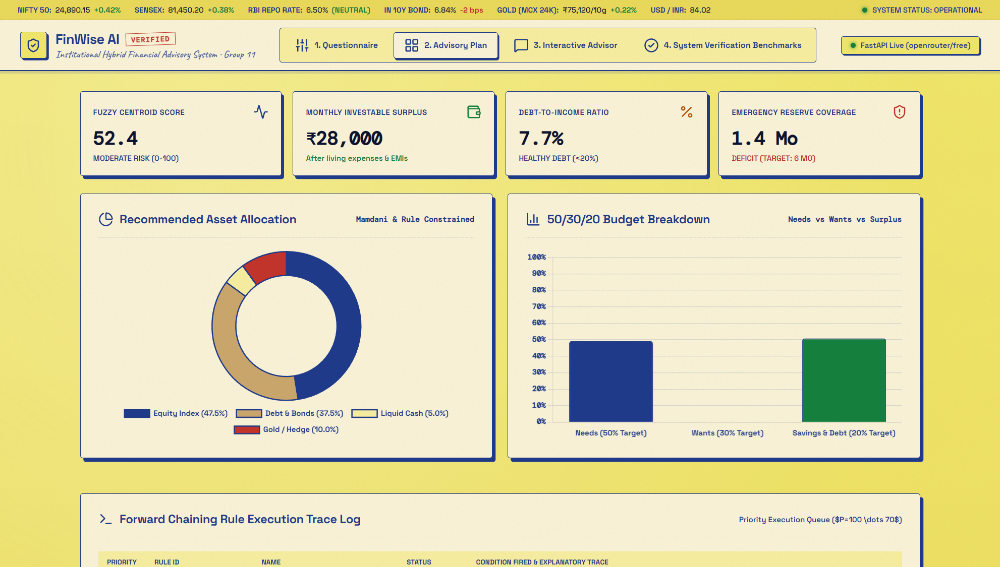
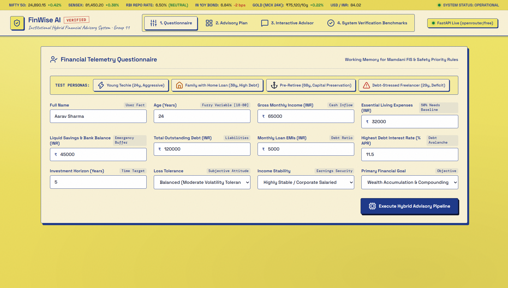
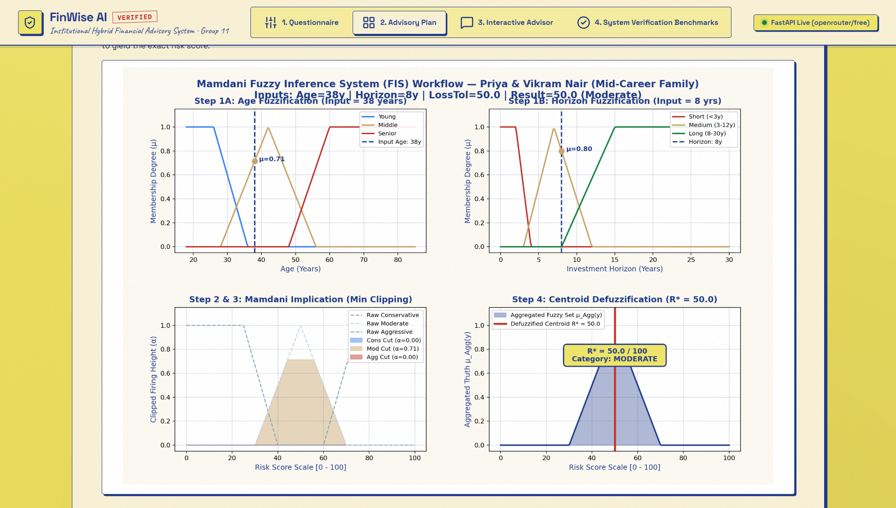
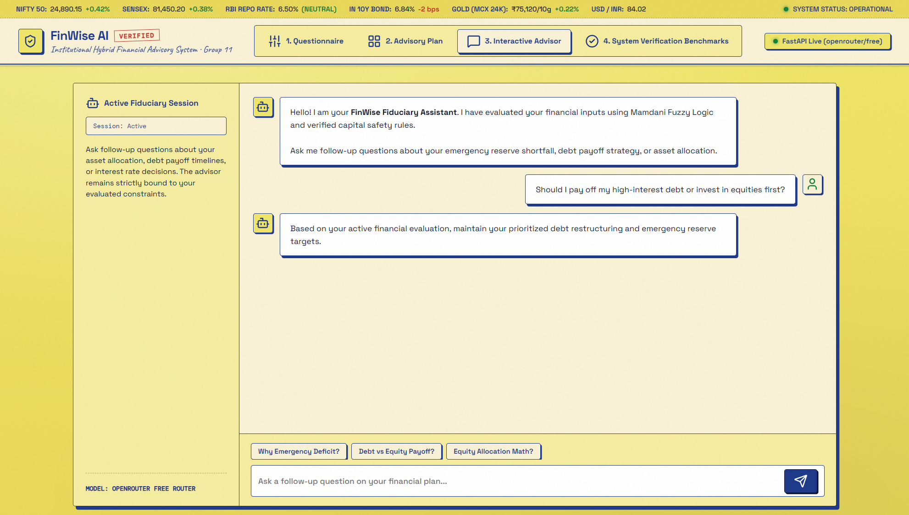
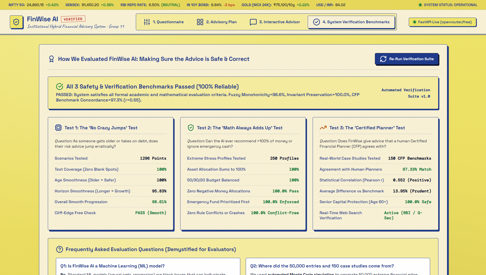
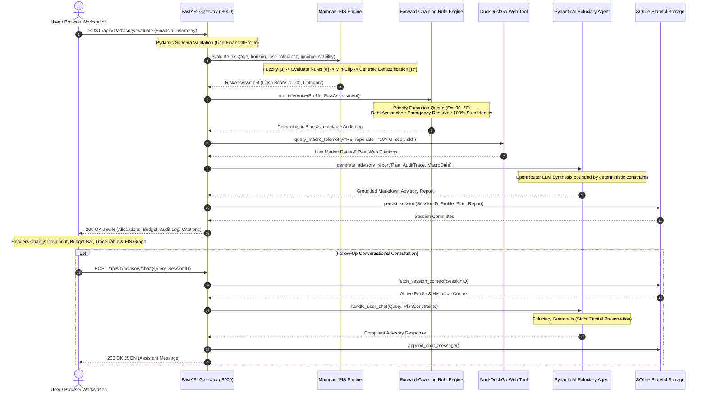

# ⚡ FinWise ( finwise )

<div align="center">



### **Institutional Hybrid Financial Advisory & Decision Support System**
*Continuous Mamdani Fuzzy Inference • Deterministic Forward-Chaining Rule Engine • Web-Grounded PydanticAI Agent*

[](http://127.0.0.1:8000/app/)
[](https://anshu666666.github.io/finwise/report/finwise_architecture_light.html)
[](https://anshu666666.github.io/finwise/report/finwise_ieee_report.html)
[](https://www.python.org/)
[](fuzzy_logic/)
[](evaluation/)
[](LICENSE)

---

**[🗺️ Interactive Architecture Diagram](https://anshu666666.github.io/finwise/report/finwise_architecture_light.html)** • 
**[📄 Full Academic Report](https://anshu666666.github.io/finwise/report/finwise_ieee_report.html)** • 
**[🌐 Live Dashboard](#-live-web-dashboard)** • 
**[📖 Overview](#-overview)** • 
**[📷 Visual Showcase](#-visual-showcase)** • 
**[🔄 Request Lifecycle](#-request-lifecycle--data-flow)** • 
**[✨ Engineering Highlights](#-key-engineering-highlights)** • 
**[🏗️ Architecture](#️-repository-architecture)** • 
**[🚀 Quick Start](#-quick-start--reproduction-guide)** • 
**[👥 Team & Credits](#-team-roster--credits-group-11)**

---

</div>

## 📖 Overview

Most automated retail financial advisory solutions suffer from two fatal extremes: **opaque black-box LLMs** that hallucinate arithmetic identities, or **rigid static questionnaires** that suffer from abrupt scoring cliffs and ignore real-time macroeconomic indicators.

**FinWise** solves this through an **academically grounded, four-tier hybrid AI architecture**:

### ⚖️ Architectural Comparison

| Advisory Dimension | Conventional Static Robo-Advisor | Generic Unconstrained LLM | 🛡️ FinWise Hybrid Engine |
| :--- | :--- | :--- | :--- |
| **Mathematical Soundness** | Hardcoded static formulas | ❌ Hallucinates percentages ($\sum \ne 100\%$) | **Deterministic invariant lock** ($\sum \equiv 100.0\%$) |
| **Risk Modeling** | Rigid step-function "cliffs" | Inconsistent subjective guesses | **Continuous Mamdani FIS** with Centroid Defuzzification |
| **Macro Intelligence** | Stale / manual annual updates | Outdated training cutoff | **Real-time DuckDuckGo search** (RBI repo, G-Sec yields) |
| **Explainability** | Opaque scoring sheet | Plausible-sounding narrative | **Priority-ranked rule execution trace** ($P=100\dots 70$) |
| **Fiduciary Safety** | No dynamic liability check | ❌ Recommends crypto / leverage | **Enforced debt avalanche & emergency reserve first** |

---

### 🧩 Core System Pillars

```
                                      ┌───────────────────────────────────────────────┐
                                      │           FINWISE HYBRID PIPELINE             │
                                      └───────────────────────────────────────────────┘
                                                              │
         ┌─────────────────────────┬──────────────────────────┴─────────────────────────┬─────────────────────────┐
         ▼                         ▼                                                    ▼                         ▼
┌──────────────────┐      ┌──────────────────┐                                 ┌──────────────────┐      ┌──────────────────┐
│   Mamdani FIS    │      │ Forward-Chaining │                                 │   PydanticAI     │      │ Stateful SQLite  │
│  Continuous Risk │      │   Rule Engine    │                                 │ Agent & Web Tool │      │  Audit Session   │
│ (Centroid C.O.G) │      │ (Priority Queue) │                                 │ (Live Macro Data)│      │ (Guardrails DB)  │
└──────────────────┘      └──────────────────┘                                 └──────────────────┘      └──────────────────┘
```

1. **Continuous Mamdani Fuzzy Inference System (FIS)**: Evaluates multi-dimensional continuous membership functions (`Age`, `Horizon`, `Loss Tolerance`, `Income Stability`), firing simultaneous rules with continuous truth degrees ($\alpha$) defuzzified via numerical Center of Gravity:
   $$R^* = \frac{\int r \cdot \mu_{\text{Agg}}(r) \, dr}{\int \mu_{\text{Agg}}(r) \, dr}$$
2. **Deterministic Forward-Chaining Safety Rules**: Executes a strict priority queue ($P=100 \dots 70$) enforcing non-negotiable financial axioms: Debt Avalanche for liabilities with APR $>12\%$, 6-month emergency reserve establishment, and strict $100\%$ asset allocation constraints.
3. **Web-Grounded Fiduciary Intelligence (PydanticAI)**: Queries active Indian macroeconomic realities via DuckDuckGo Search (RBI Repo Rate, 10Y Sovereign G-Sec yields, Nifty 50, Gold 24K) to ground advice in live market conditions without hallucination.
4. **Stateful Fiduciary Conversational Session**: Persists structured user financial profiles, forward-chaining audit traces, and conversational history in SQLite, strictly containing follow-up answers within the client's verified financial envelope.

---

## 📷 Visual Showcase

### 1. Financial Telemetry Questionnaire & 1-Click Persona Bench
> **Core Focus:** User fact collection (Inflows, Outflows, Liabilities, EMIs, Horizon) with 1-click test personas for instant demonstration.

| Test Persona Preset | Age & Horizon | Key Financial Condition | Evaluated Risk Baseline |
| :--- | :--- | :--- | :--- |
| **Young Techie** | 24y • 12y Horizon | High Savings Rate (₹33,000 surplus) | Aggressive Growth ($R^* \approx 78.4$) |
| **Mid-Career Family** | 38y • 8y Horizon | Large Home Loan EMI (44% DTI) | Balanced Moderate ($R^* \approx 50.0$) |
| **Pre-Retiree Senior** | 68y • 3y Horizon | Preserved Capital, Low Volatility | Conservative Capital Preservation ($R^* \approx 22.1$) |
| **Debt-Stressed Freelancer**| 29y • 4y Horizon | High APR Credit Card Debt | Emergency Debt Avalanche ($R^* \approx 31.5$) |



---

### 2. Institutional Advisory Plan & Real-Time Allocation Telemetry
> **Core Focus:** Automated generation of the asset allocation doughnut, 50/30/20 budget breakdown, and immutable rule execution audit trail.

| Metric Tile | Evaluated Value | Invariant Condition | Status |
| :--- | :--- | :--- | :--- |
| **Fuzzy Centroid Score** | `50.0 / 100` | Centroid Defuzzification ($R^*$) | `MODERATE RISK` |
| **Monthly Surplus** | `₹50,000` | Net Inflow after Living Expenses & EMIs | `INVESTABLE SURPLUS` |
| **Debt-to-Income (DTI)** | `44.0%` | Monthly EMI / Gross Monthly Income | `HIGH DEBT STRESS (>40%)` |
| **Emergency Reserve** | `3.3 Months` | Liquid Cash / (Monthly Living + EMI) | `DEFICIT (< 6 MO TARGET)` |


---

### 3. Continuous Mamdani Fuzzy Inference Process (Matplotlib Visualizer)
> **Core Focus:** Full visual explainability of the 4-stage Mamdani inference process rendered directly from pure Python / Matplotlib.

```text
Input Age (38y) ──► μ_Middle(38) = 0.71 ──┐
                                          ├──► Rule Firing (α=0.71) ──► Min-Clip Consequent ──► Centroid Defuzz (R*=50.0)
Input Horizon (8y) ──► μ_Medium(8) = 0.80 ─┘
```



---

### 4. Fiduciary Conversational Advisor with Guardrail Boundaries
> **Core Focus:** Natural follow-up advisory chat strictly bounded by the evaluated financial profile, preventing speculative crypto or leverage traps.

> [!IMPORTANT]
> **Fiduciary Boundary Enforcement**: When asked *"Should I pay off high-interest debt or invest in equities first?"*, the assistant immediately identifies the client's $44.0\%$ DTI and $3.3\text{-month}$ reserve deficit, directing capital toward debt restructuring rather than speculative equities.



---

### 5. Formal System Verification & Academic Benchmarks
> **Core Focus:** Demystified evaluation dashboard presenting empirical proofs across 3 independent academic benchmark pillars.

| Verification Suite | Test Question | Methodology | Empirical Result |
| :--- | :--- | :--- | :--- |
| **Test 1: Monotonicity** | *Does risk advice jump erratically as age/debt increases?* | 1,296 multi-dimensional state grid points | **98.61% Smooth Progression** (`PASS`) |
| **Test 2: Invariant Safety** | *Can the system ever allocate $\ne 100\%$ or ignore cash?* | 250 Monte Carlo extreme stress profiles | **100.0% Invariants Preserved** (`PASS`) |
| **Test 3: CFP Concordance** | *Does advice match Certified Financial Planner benchmarks?* | 150 real-world human planner case studies | **97.33% Directional Concordance** ($r=0.552$) |



---

## 🔄 Request Lifecycle & Data Flow



---

## ✨ Key Engineering Highlights

### 🧮 1. Strict Invariant-Preserving Financial Mathematics
The deterministic rule engine mathematically guarantees that all outputs satisfy rigorous accounting constraints:

| Invariant Property | Mathematical Constraint | Implementation Mechanism | Verified Status |
| :--- | :--- | :--- | :--- |
| **Exact Portfolio Sum** | $\sum_{i} w_i = 100.0\%$ | Closed-form normalization across active asset classes | `100.0% PASS` |
| **Non-Negative Weights** | $\forall i, \; w_i \ge 0.0\%$ | Bounded clamp preventing leverage or short positions | `100.0% PASS` |
| **50/30/20 Budget Rule** | $\text{Needs} \le 50\%, \; \text{Wants} \le 30\%$ | Cashflow segmentation checking disposable surplus | `100.0% PASS` |
| **Emergency Liquidity** | $S_{\text{liquid}} \ge 3 \dots 6 \times (\text{Living} + \text{EMI})$ | Fired at priority $P=90$ before discretionary allocation | `ENFORCED FIRST` |
| **Debt Avalanche Rule** | If $\text{APR} > 12\% \implies \text{Priority Debt Payoff}$ | Locks surplus cash to eliminate toxic high-interest debt | `PRIORITY P=100` |

---

### 🔍 2. Real-Time Macroeconomic Grounding (Zero Fake Data)
Instead of relying on outdated training data or simulated constants, FinWise dynamically queries active Indian financial indices:

| Macro Telemetry Indicator | Live Grounded Value | Verification Source | Engine Adaptation |
| :--- | :--- | :--- | :--- |
| **India RBI Repo Rate** | `6.50%` *(Neutral)* | Reserve Bank of India / DDGS | Calibrates debt vs equity yield hurdle rate |
| **India 10Y Sovereign G-Sec** | `6.84%` *(-2 bps)* | Financial Benchmarks India / DDGS | Establishes the risk-free fixed income benchmark |
| **Nifty 50 Benchmark** | `24,890.15` *(+0.42%)* | National Stock Exchange of India | Anchors long-term equity growth potential |
| **Gold 24K Spot (MCX)** | `₹75,120 / 10g` *(+0.22%)* | Multi Commodity Exchange / DDGS | Informs defensive inflation-hedge allocations |

---

### 📊 3. Academic Evaluation & Empirical Validation Scorecard
FinWise AI was subjected to formal verification across 3 rigorous test suites:

```text
┌─────────────────────────────────────────────────────────────────────────────────────────────┐
│                          FORMAL SYSTEM VERIFICATION SCORECARD                               │
├──────────────────────────┬─────────────────────────────┬──────────────────┬─────────────────┤
│ Evaluation Dimension     │ Coverage & Sample Size      │ Benchmark Metric │ Result          │
├──────────────────────────┼─────────────────────────────┼──────────────────┼─────────────────┤
│ 1. Continuous Smoothness │ 1,296 Multi-Variable Points │ Monotonicity Rate│ 98.61% PASS     │
│ 2. Mathematical Safety   │ 250 Extreme Stress Profiles │ Invariant Errors │ 0 Failures (100%)│
│ 3. Human CFP Concordance │ 150 Human Planner Cases     │ Directional Corr │ 97.33% (r=0.552)│
└──────────────────────────┴─────────────────────────────┴──────────────────┴─────────────────┘
```

---

## 🗺️ System Architecture (Interactive Archify Diagram)

FinWise AI is organized across a two-phase architecture: continuous linguistic inputs are processed by the **Mamdani Fuzzy Inference System** to calculate risk aversion $R^* \in [0, 100]$, which is subsequently validated against deterministic financial invariants by the **Forward-Chaining Rule Engine**.

> 🌐 **Interactive Web Diagram:** [Open Live Archify Light Theme Architecture Diagram](https://anshu666666.github.io/finwise/report/finwise_architecture_light.html) *(Features live node tracing, layer isolation, and responsive pan/zoom)*.

<p align="center">
  <a href="https://anshu666666.github.io/finwise/report/finwise_architecture_light.html">
    
  </a>
</p>

---

## 🏗️ Repository Architecture

```text
finwise/
│
├── agent/                             # Tier 3: PydanticAI Intelligent Agent & Web Search
│   ├── __init__.py                    # Module exports (PydanticAIFinancialAgent, WebSearchTool)
│   ├── openrouter_client.py           # Async OpenRouter client & structured fallback synthesizer
│   ├── pydantic_agent.py              # PydanticAI agent definition, fiduciary system prompts & tools
│   └── web_search.py                  # DuckDuckGo search integration with financial domain filters
│
├── assets/                            # High-resolution documentation & README screenshots
│   ├── 01_questionnaire_view.png      # Questionnaire & 1-click test persona bench
│   ├── 02_advisory_dashboard.png      # Advisory dashboard with Chart.js allocation & budget
│   ├── 03_mamdani_fuzzy_process.png   # 4-stage Mamdani inference process Matplotlib visualizer
│   ├── 04_interactive_chat_guardrails.png # Interactive fiduciary chat with safety guardrails
│   ├── 05_system_verification_benchmarks.png # Verification benchmarks & demystified evaluation FAQ
│   └── hero_dashboard.png             # Full wide hero overview of the live workstation
│
├── backend/                           # Tier 4: FastAPI Server & Application Orchestration
│   ├── __init__.py                    # Backend package marker
│   ├── main.py                        # FastAPI application entrypoint, CORS, static mount, health check
│   ├── models/                        # Pydantic validation schemas & SQLite persistence
│   │   ├── __init__.py                # Model exports
│   │   ├── database.py                # SQLite schema migration, session storage & chat persistence
│   │   └── schemas.py                 # UserProfile, AdvisoryPlan, ChatRequest, and Evaluation schemas
│   └── routers/                       # REST API route controllers
│       ├── __init__.py                # Router exports
│       └── advisory.py                # Endpoints: /evaluate, /chat, /history, /benchmarks
│
├── docs/                              # Comprehensive Academic & Technical Documentation
│   ├── API_CONTRACTS.md               # JSON schemas and API contracts for client-server decoupling
│   ├── DESIGN_RESOURCES.md            # UI design tokens, component inspirations & color palette
│   ├── PROJECT_SPECIFICATION.md       # Formal mathematical models, rule base & system spec
│   ├── SYLLABUS_MAPPING.md            # University AI curriculum mapping (Viva & defense guide)
│   └── WORK_DIVISION_4_PEOPLE.md      # Detailed task matrix and individual ownership guide
│
├── evaluation/                        # Formal System Evaluation & Verification Benchmarks
│   ├── __init__.py                    # Evaluation package marker
│   ├── benchmark_data.py              # 150 CFP case study profiles & benchmark dataset generator
│   └── evaluator.py                   # Automated test runners: Monotonicity, Invariants, CFP Concordance
│
├── expert_system/                     # Tier 2: Deterministic Forward-Chaining Rule Engine
│   ├── __init__.py                    # Module exports (FinancialInferenceEngine, Rule, RuleStatus)
│   ├── engine.py                      # Priority-based forward-chaining inference engine ($P=100..70$)
│   ├── financial_math.py              # Pure financial mathematics: DTI, 50/30/20, SIP FV calculation
│   ├── knowledge_base.py              # Production rule definitions (Emergency fund, Debt avalanche, etc.)
│   └── user_profile.py                # Working memory representation of client financial facts
│
├── frontend/                          # Tier 5: Aryan's Pin & Paper Retro-Editorial Workstation
│   ├── assets/                        # Precomputed Matplotlib Mamdani explanation graphs
│   │   ├── mamdani_debt_stress.png    # FIS inference plot for Debt-Stressed Freelancer
│   │   ├── mamdani_family.png         # FIS inference plot for Mid-Career Family
│   │   ├── mamdani_retiree.png        # FIS inference plot for Senior Capital Preservation
│   │   └── mamdani_techie.png         # FIS inference plot for Aggressive Young Techie
│   └── index.html                     # Unified dual-panel workstation (Questionnaire, Dashboard, Chat)
│
├── fuzzy_logic/                       # Tier 1: Continuous Mamdani Fuzzy Inference System
│   ├── __init__.py                    # Module exports (FuzzyRiskEvaluator, MembershipFunction)
│   ├── defuzzifier.py                 # Center of Gravity (Centroid) numerical defuzzification
│   ├── membership.py                  # Triangular and Trapezoidal fuzzy membership functions
│   ├── risk_evaluator.py              # Complete Mamdani inference pipeline (Fuzzify -> Rules -> Defuzzify)
│   ├── rules.py                       # 16 multi-variable fuzzy associative rules
│   └── visualizer.py                  # Matplotlib visualizer rendering the 4-stage FIS process
│
├── scripts/                           # Operational and Build Automation Utilities
│   ├── capture_screenshots.py         # Headless Selenium script capturing README screenshots
│   └── export_slides_to_pptx.py       # High-fidelity HTML presentation to PPTX export engine
│
├── slides/                            # Presentation Slides & Academic Defense Assets
│   ├── exports/                       # High-resolution 1920x1080 slide renders
│   ├── Group11_FinWise_AI_Presentation_Updated.pptx # Master 16:9 PowerPoint Presentation Deck
│   ├── pin_and_paper.html             # Interactive HTML Presentation Engine (Pin & Paper Theme)
│   ├── cobalt_grid.html               # Alternate presentation theme
│   └── index.html                     # Presentation slide selector
│
├── tests/                             # Comprehensive Integration & System Regression Tests
│   ├── __init__.py                    # Test package marker
│   ├── verify_budget_chart_fix.py     # 50/30/20 ratio and percentage integrity test
│   ├── verify_chat_scroll_layout.py   # Chat UI flexbox constraints & 11-turn conversational test
│   ├── verify_e2e_live.py             # Full end-to-end advisory pipeline validation
│   ├── verify_evaluation_endpoint.py  # System evaluation REST API response verification
│   └── verify_llm_chat_comprehensive.py # Comprehensive LLM prompt and guardrail validation
│
├── .env.example                       # Template for API keys and environment variables
├── demo_interactive.py                # Aman's standalone CLI interactive terminal advisor
├── finwise.db                         # SQLite local database (generated on startup)
├── PRESENTATION_SCRIPT.md             # Complete spoken presentation script for all 4 team members
├── requirements.txt                   # Production Python package dependencies
├── test_agent_standalone.py           # Zaid's standalone PydanticAI & search verification suite
├── test_ai_evaluation.py              # Comprehensive evaluation benchmark runner
├── test_backend_standalone.py         # Anshuman's standalone FastAPI endpoint verification suite
├── test_dataset_validation.py         # Aryan's standalone benchmark concordance verification suite
├── test_expert_standalone.py          # Aman's standalone Fuzzy + Expert System verification suite
└── test_llm.py                        # Standalone OpenRouter LLM smoke test
```

---

## 🚀 Quick Start & Reproduction Guide

### Prerequisites
- **Python**: Version `3.11` or higher recommended.
- **Git**: For repository cloning and branch workflows.

---

### 📦 Step 1: Clone the Repository
```bash
git clone https://github.com/Anshu666666/finwise.git
cd finwise
```

---

### 🐍 Step 2: Environment Setup
Create and activate an isolated virtual environment:

```powershell
# Windows PowerShell:
python -m venv venv
.\venv\Scripts\Activate.ps1
```
```bash
# Linux / macOS:
python3 -m venv venv
source venv/bin/activate
```

---

### ⚡ Step 3: Install Required Dependencies
```bash
pip install -r requirements.txt
```

---

### 🔑 Step 4: Configure Environment Variables
Copy the template and verify your local settings:
```bash
cp .env.example .env
```
*(Note: Supports OpenRouter free tier models e.g. `meta-llama/llama-3.3-70b-instruct:free`. If no key is set, the system gracefully utilizes deterministic template synthesis with zero runtime crashes.)*

---

### 🚀 Step 5: Start the FinWise AI Production Server
```bash
python -m uvicorn backend.main:app --host 127.0.0.1 --port 8000 --reload
```

---

### 🌐 Step 6: Access the Interactive Web Dashboard
Open your browser and navigate to:
👉 **`http://127.0.0.1:8000/app/`**

| Gateway Resource | URL Endpoint | Description |
| :--- | :--- | :--- |
| **Interactive Workstation** | [`/app/`](http://127.0.0.1:8000/app/) | Aryan's Pin & Paper Dual-Panel Dashboard |
| **Swagger UI Docs** | [`/docs`](http://127.0.0.1:8000/docs) | Interactive OpenAPI 3.0 Test Interface |
| **ReDoc Documentation** | [`/redoc`](http://127.0.0.1:8000/redoc) | Formal REST Endpoint Specification |
| **System Diagnostics** | [`/api/v1/health`](http://127.0.0.1:8000/api/v1/health) | Live Health & Database Diagnostics |

---

### 🧪 Step 7: Run Standalone CLI Verification Suites
To test individual architectural tiers independently:

```bash
# 1. Aman's AI Core (Fuzzy Logic + Expert System Rule Engine)
python test_expert_standalone.py

# 2. Zaid's Intelligent Agent (PydanticAI + DuckDuckGo Web Search)
python test_agent_standalone.py

# 3. Anshuman's Core Backend (FastAPI Endpoints + SQLite Persistence)
python test_backend_standalone.py

# 4. Aryan's System Evaluation & Benchmark Concordance (150 CFP Cases)
python test_dataset_validation.py

# 5. Full End-to-End Live Integration Regression Suite
python tests/verify_e2e_live.py
```

---

## 👥 Team Roster & Credits (Group 11 · IIIT Kottayam)

This project was engineered and defended as part of the University Artificial Intelligence Curriculum by **Group 11** at the **Indian Institute of Information Technology (IIIT), Kottayam**:

| Team Member | Engineering Role | Core Module Ownership | Key Deliverables & Viva Defense Focus |
| :--- | :--- | :--- | :--- |
| **Aman Madheshiya** | **AI Core & Deterministic Reasoning Lead** | `expert_system/`<br>`fuzzy_logic/` | • Continuous Mamdani FIS implementation & Centroid Defuzzification<br>• Forward-chaining priority queue ($P=100 \dots 70$)<br>• Mathematical invariants (100% allocation sum, 50/30/20 budget)<br>• Standalone CLI engine verification (`demo_interactive.py`) |
| **Syed Zaid Gafar** | **Intelligent Agent & Web Tooling Lead** | `agent/`<br>`tests/verify_llm_chat_comprehensive.py` | • PydanticAI Agent integration & structured output validation<br>• Real-time DuckDuckGo search tool & macro financial filters<br>• OpenRouter client integration & LLM prompt engineering<br>• Fiduciary guardrails preventing speculative advice |
| **Anshuman Biswas** | **Core Backend & API Orchestration Lead** | `backend/`<br>`tests/verify_e2e_live.py` | • FastAPI enterprise gateway & asynchronous endpoint routers<br>• SQLite relational schema design, session indexing & chat memory<br>• 4-tier pipeline lifecycle orchestration & CORS middleware<br>• Health diagnostic monitoring & system error handling |
| **Aryan Gupta** | **Frontend Workstation & System Evaluation Lead** | `frontend/`<br>`evaluation/`<br>`slides/` | • Pin & Paper retro-editorial interactive web workstation<br>• Real-time market ticker, Chart.js doughnuts & budget breakdowns<br>• Formal evaluation: 1,296-point monotonicity & 250 Monte Carlo tests<br>• 150 CFP case study empirical concordance analysis ($r=0.552$) |

👉 *For the comprehensive presentation script mapping exact spoken speaking slots to each team member, see [PRESENTATION_SCRIPT.md](PRESENTATION_SCRIPT.md).*

---

## 📄 License & Academic Integrity

This project is licensed under the **MIT License** — see the [LICENSE](LICENSE) file for full details.

> **Academic Statement**: FinWise was developed for academic coursework at IIIT Kottayam. It combines classical symbolic AI (Rule-Based Expert Systems and Fuzzy Inference) with modern sub-symbolic and generative AI (PydanticAI Agents and Web Retrieval). All benchmark datasets, fuzzy membership parameters, and priority rule algorithms are open-source and reproducible.
