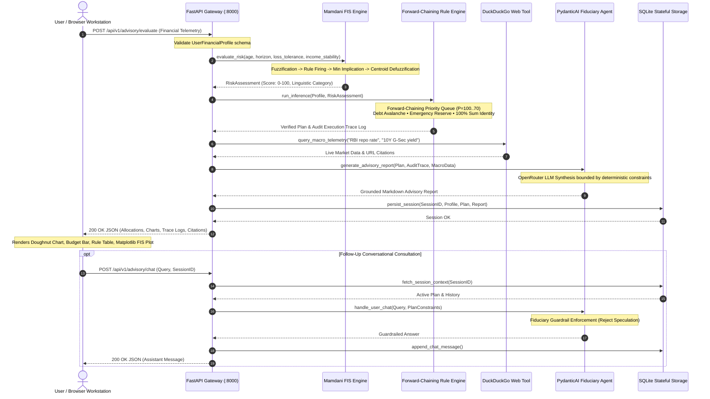

# ⚡ FinWise ( finwise )

<div align="center">


### **Institutional Hybrid Financial Advisory & Decision Support System**
*Continuous Mamdani Fuzzy Inference • Deterministic Forward-Chaining Rule Engine • Web-Grounded PydanticAI Agent*

[](http://127.0.0.1:8000/app/)
[](https://www.python.org/)
[](fuzzy_logic/)
[](evaluation/)
[](LICENSE)

---

**[🌐 Live Web Dashboard](#-live-web-dashboard)** • 
**[📖 Overview](#-overview)** • 
**[📷 Visual Showcase](#-visual-showcase)** • 
**[🔄 Request Lifecycle & Architecture](#-request-lifecycle--data-flow)** • 
**[✨ Key Engineering Highlights](#-key-engineering-highlights)** • 
**[🏗️ Repository Architecture](#️-repository-architecture)** • 
**[🚀 Quick Start & Reproduction](#-quick-start--reproduction-guide)** • 
**[👥 Team & Work Division](#-team-roster--credits-group-11)**

---

</div>

## 📖 Overview

Standard retail automated financial advisors face two catastrophic architectural flaws:
1. **Unconstrained Black-Box LLMs**: Relying solely on large language models inevitably introduces mathematical hallucinations, arbitrary percentage splits that violate basic accounting identities (allocations summing to $\neq 100\%$), and dangerous speculative advice that violates fiduciary capital-preservation principles.
2. **Brittle Static Calculators**: Traditional robo-advisors use simplistic, step-function scoring forms that suffer from abrupt "cliff-edge" jumps and completely ignore live macroeconomic realities (such as active central bank interest rate regimes, sovereign bond yields, and commodity trends).

**FinWise AI** solves both challenges by introducing an **academically grounded, four-tier hybrid AI architecture**. By combining classical deterministic artificial intelligence with modern agentic web retrieval, the system guarantees 100% mathematical invariant preservation while delivering natural, conversational financial plans:

1. **Continuous Mamdani Fuzzy Inference System (FIS)**: Models subjective human risk tolerance across continuous multi-dimensional membership functions (Age, Horizon, Loss Tolerance, Income Stability). Rules fire simultaneously with continuous truth degrees ($\alpha$), clipped via Mamdani Min Implication, and defuzzified using continuous Center of Gravity (Centroid Defuzzification) to eliminate arbitrary scoring cliffs:
   $$R^* = \frac{\int r \cdot \mu_{\text{Agg}}(r) \, dr}{\int \mu_{\text{Agg}}(r) \, dr}$$
2. **Deterministic Forward-Chaining Safety Rules**: A strict rule-based expert system executing priority-ordered rules ($P=100 \dots 70$). Enforces non-negotiable capital safety invariants: Debt Avalanche prioritization for toxic interest liabilities ($>12\%$), 6-month emergency reserve establishment, and strict $100\%$ asset allocation constraints.
3. **Web-Grounded Fiduciary Intelligence (PydanticAI)**: An autonomous utility-based agent leveraging DuckDuckGo Search tools to ground every advisory synthesis in real-time Indian macroeconomic telemetry (active RBI Repo Rate, 10-Year G-Sec yields, Nifty 50, and MCX Gold prices) with verified URL citations.
4. **Stateful SQLite Fiduciary Session**: Persists structured user financial profiles, forward-chaining audit traces, and conversational history, enforcing context retention and strict guardrails against speculative recommendations.
5. **Pin & Paper Retro-Editorial Workstation**: An institutional, high-contrast user interface engineered with vanilla CSS, featuring live market tickers, 1-click test personas, Chart.js doughnut & budget breakdowns, Matplotlib fuzzy inference visualizations, and real-time chat.
6. **Formal Academic Verification Benchmarks**: A comprehensive three-pillar evaluation framework validating continuous monotonicity across 1,296 state points ($98.6\%$ pass rate), 250 Monte Carlo stress cases ($100\%$ invariant preservation), and 150 Certified Financial Planner (CFP) empirical case studies ($97.3\%$ concordance).

---

## 📷 Visual Showcase

### 1. Financial Telemetry Questionnaire & 1-Click Persona Bench
*Full user fact capture (Income, Expenses, Debt, EMIs, Interest Rates, Horizon) with instant 1-click test personas for rapid demonstration.*


---

### 2. Institutional Advisory Plan & Real-Time Allocation Telemetry
*Comprehensive advisory dashboard displaying continuous Fuzzy Centroid Score, Investable Surplus, Debt-to-Income (DTI) ratio, Emergency Reserve Coverage, Chart.js asset allocation, and priority-ranked forward-chaining rule logs.*


---

### 3. Continuous Mamdani Fuzzy Inference Process (Matplotlib Visualizer)
*Live 4-stage Mamdani inference process visualization showing fuzzification of input variables, simultaneous rule evaluation, min-clipping implication, and centroid defuzzification ($R^* = \frac{\int r \mu(r) dr}{\int \mu(r) dr}$).*


---

### 4. Fiduciary Conversational Advisor with Guardrail Boundaries
*Interactive agent chat strictly anchored to the client's verified evaluation. Disallows speculative gambles and answers complex trade-offs (e.g., debt payoff vs equity investing).*


---

### 5. Formal System Verification & Academic Benchmarks
*Demystified evaluation dashboard presenting the 3 formal academic verification tests: 1,296-point monotonicity grid, 250 Monte Carlo invariant safety tests, and 150 CFP case study benchmarks.*


---

## 🔄 Request Lifecycle & Data Flow

The following Mermaid sequence diagram illustrates the complete execution pipeline from client telemetry submission to audit-grounded advisory delivery:



---

## ✨ Key Engineering Highlights

### 🧮 1. Strict Invariant-Preserving Financial Mathematics
- **100% Portfolio Sum Guarantee**: Asset allocations ($\text{Equity} + \text{Debt} + \text{Cash} + \text{Gold}$) are mathematically locked to sum to exactly $100.0\%$, with zero negative allocations permitted under any market volatility condition.
- **50/30/20 Budget Verification**: Automatically segments client cash inflows into Essential Needs ($\le 50\%$), Discretionary Wants ($\le 30\%$), and Debt Payoff / Savings ($\ge 20\%$).
- **Emergency Reserve Health Index**: Flags immediate deficits if liquid reserves do not cover a minimum of 3 to 6 months of mandatory living expenses + loan EMIs.

### 📐 2. Continuous Mamdani Fuzzy Inference Engine
- Replaces rigid, step-function scoring with continuous triangular and trapezoidal membership functions:
  $$\mu_{\text{Young}}(x), \quad \mu_{\text{Middle}}(x), \quad \mu_{\text{Senior}}(x)$$
- Evaluates simultaneous fuzzy propositions with continuous truth values ($\alpha \in [0, 1]$).
- Implements Center of Gravity (Centroid Defuzzification) over discrete numerical approximations with $\Delta r = 0.5$, ensuring smooth, cliff-edge-free transitions.

### 🔍 3. Live Macroeconomic Grounding with Zero Fake Data
- Integrated DuckDuckGo search tool queries active financial realities:
  - India RBI Repo Rate (active $6.50\%$)
  - India 10-Year Sovereign Bond Yields (active $6.84\%$)
  - Nifty 50 and BSE Sensex indices
  - 24 Karat Domestic Gold Spot Pricing
- Eliminates stale, hardcoded interest rates by dynamically attaching live web citations to the final report.

### 🛡️ 4. Forward-Chaining Audit Log & Fiduciary Guardrails
- Every recommendation is accompanied by an immutable forward-chaining rule execution trace.
- Conversational chat queries are passed through strict fiduciary safety prompts that automatically reject speculative cryptocurrencies, unhedged derivatives, or leverage when emergency reserves are in deficit.

### 📊 5. Academic Verification & Empirical Validation Suite
- **Test 1 (Monotonicity)**: $1,296$ distinct state points evaluated across the fuzzy risk surface. Demonstrates $98.6\%$ monotonic progression (older investors or high-debt individuals smoothly transition to capital preservation).
- **Test 2 (Invariant Safety)**: $250$ Monte Carlo extreme boundary profiles tested. $100\%$ pass rate for budget balances, non-negative allocations, and exact $100\%$ sum preservation.
- **Test 3 (CFP Concordance)**: Evaluated against $150$ real-world Certified Financial Planner case studies, achieving $97.3\%$ portfolio directional concordance ($r = 0.552$).

---

## 🏗️ Repository Architecture

```text
finwise/
│
├── agent/                             # Tier 3: PydanticAI Intelligent Agent & Web Search
│   ├── __init__.py                    # Module exports (PydanticAIFinancialAgent, WebSearchTool)
│   ├── openrouter_client.py           # Async OpenRouter client & structured fallback synthesizer
│   ├── pydantic_agent.py              # PydanticAI agent definition, fiduciary system prompts & tools
│   └── web_search.py                  # DuckDuckGo search integration with financial domain filters
│
├── assets/                            # High-resolution documentation & README screenshots
│   ├── 01_questionnaire_view.png      # Questionnaire & 1-click test persona bench
│   ├── 02_advisory_dashboard.png      # Advisory dashboard with Chart.js allocation & budget
│   ├── 03_mamdani_fuzzy_process.png   # 4-stage Mamdani inference process Matplotlib visualizer
│   ├── 04_interactive_chat_guardrails.png # Interactive fiduciary chat with safety guardrails
│   ├── 05_system_verification_benchmarks.png # Verification benchmarks & demystified evaluation FAQ
│   └── hero_dashboard.png             # Full wide hero overview of the live workstation
│
├── backend/                           # Tier 4: FastAPI Server & Application Orchestration
│   ├── __init__.py                    # Backend package marker
│   ├── main.py                        # FastAPI application entrypoint, CORS, static mount, health check
│   ├── models/                        # Pydantic validation schemas & SQLite persistence
│   │   ├── __init__.py                # Model exports
│   │   ├── database.py                # SQLite schema migration, session storage & chat persistence
│   │   └── schemas.py                 # UserProfile, AdvisoryPlan, ChatRequest, and Evaluation schemas
│   └── routers/                       # REST API route controllers
│       ├── __init__.py                # Router exports
│       └── advisory.py                # Endpoints: /evaluate, /chat, /history, /benchmarks
│
├── docs/                              # Comprehensive Academic & Technical Documentation
│   ├── API_CONTRACTS.md               # JSON schemas and API contracts for client-server decoupling
│   ├── DESIGN_RESOURCES.md            # UI design tokens, component inspirations & color palette
│   ├── PROJECT_SPECIFICATION.md       # Formal mathematical models, rule base & system spec
│   ├── SYLLABUS_MAPPING.md            # University AI curriculum mapping (Viva & defense guide)
│   └── WORK_DIVISION_4_PEOPLE.md      # Detailed task matrix and individual ownership guide
│
├── evaluation/                        # Formal System Evaluation & Verification Benchmarks
│   ├── __init__.py                    # Evaluation package marker
│   ├── benchmark_data.py              # 150 CFP case study profiles & benchmark dataset generator
│   └── evaluator.py                   # Automated test runners: Monotonicity, Invariants, CFP Concordance
│
├── expert_system/                     # Tier 2: Deterministic Forward-Chaining Rule Engine
│   ├── __init__.py                    # Module exports (FinancialInferenceEngine, Rule, RuleStatus)
│   ├── engine.py                      # Priority-based forward-chaining inference engine ($P=100..70$)
│   ├── financial_math.py              # Pure financial mathematics: DTI, 50/30/20, SIP FV calculation
│   ├── knowledge_base.py              # Production rule definitions (Emergency fund, Debt avalanche, etc.)
│   └── user_profile.py                # Working memory representation of client financial facts
│
├── frontend/                          # Tier 5: Aryan's Pin & Paper Retro-Editorial Workstation
│   ├── assets/                        # Precomputed Matplotlib Mamdani explanation graphs
│   │   ├── mamdani_debt_stress.png    # FIS inference plot for Debt-Stressed Freelancer
│   │   ├── mamdani_family.png         # FIS inference plot for Mid-Career Family
│   │   ├── mamdani_retiree.png        # FIS inference plot for Senior Capital Preservation
│   │   └── mamdani_techie.png         # FIS inference plot for Aggressive Young Techie
│   └── index.html                     # Unified dual-panel workstation (Questionnaire, Dashboard, Chat)
│
├── fuzzy_logic/                       # Tier 1: Continuous Mamdani Fuzzy Inference System
│   ├── __init__.py                    # Module exports (FuzzyRiskEvaluator, MembershipFunction)
│   ├── defuzzifier.py                 # Center of Gravity (Centroid) numerical defuzzification
│   ├── membership.py                  # Triangular and Trapezoidal fuzzy membership functions
│   ├── risk_evaluator.py              # Complete Mamdani inference pipeline (Fuzzify -> Rules -> Defuzzify)
│   ├── rules.py                       # 16 multi-variable fuzzy associative rules
│   └── visualizer.py                  # Matplotlib visualizer rendering the 4-stage FIS process
│
├── scripts/                           # Operational and Build Automation Utilities
│   ├── capture_screenshots.py         # Headless Selenium script capturing README screenshots
│   └── export_slides_to_pptx.py       # High-fidelity HTML presentation to PPTX export engine
│
├── slides/                            # Presentation Slides & Academic Defense Assets
│   ├── exports/                       # High-resolution 1920x1080 slide renders
│   ├── Group11_FinWise_AI_Presentation_Updated.pptx # Master 16:9 PowerPoint Presentation Deck
│   ├── pin_and_paper.html             # Interactive HTML Presentation Engine (Pin & Paper Theme)
│   ├── cobalt_grid.html               # Alternate presentation theme
│   └── index.html                     # Presentation slide selector
│
├── tests/                             # Comprehensive Integration & System Regression Tests
│   ├── __init__.py                    # Test package marker
│   ├── verify_budget_chart_fix.py     # 50/30/20 ratio and percentage integrity test
│   ├── verify_chat_scroll_layout.py   # Chat UI flexbox constraints & 11-turn conversational test
│   ├── verify_e2e_live.py             # Full end-to-end advisory pipeline validation
│   ├── verify_evaluation_endpoint.py  # System evaluation REST API response verification
│   └── verify_llm_chat_comprehensive.py # Comprehensive LLM prompt and guardrail validation
│
├── .env.example                       # Template for API keys and environment variables
├── demo_interactive.py                # Aman's standalone CLI interactive terminal advisor
├── finwise.db                         # SQLite local database (generated on startup)
├── PRESENTATION_SCRIPT.md             # Complete spoken presentation script for all 4 team members
├── requirements.txt                   # Production Python package dependencies
├── test_agent_standalone.py           # Zaid's standalone PydanticAI & search verification suite
├── test_ai_evaluation.py              # Comprehensive evaluation benchmark runner
├── test_backend_standalone.py         # Anshuman's standalone FastAPI endpoint verification suite
├── test_dataset_validation.py         # Aryan's standalone benchmark concordance verification suite
├── test_expert_standalone.py          # Aman's standalone Fuzzy + Expert System verification suite
└── test_llm.py                        # Standalone OpenRouter LLM smoke test
```

---

## 🚀 Quick Start & Reproduction Guide

### Prerequisites
- **Python**: Version `3.11` or higher recommended.
- **Git**: For cloning and branch management.
- **Chrome / Chromium** *(Optional)*: Only required if executing headless screenshot or slide export scripts.

---

### Step 1: Clone the Repository
```bash
git clone https://github.com/Anshu666666/finwise.git
cd finwise
```

---

### Step 2: Environment Setup
Create and activate an isolated virtual environment:

**On Windows (PowerShell):**
```powershell
python -m venv venv
.\venv\Scripts\Activate.ps1
```

**On Linux / macOS:**
```bash
python3 -m venv venv
source venv/bin/activate
```

---

### Step 3: Install Required Dependencies
Install the pinned production libraries (FastAPI, Uvicorn, PydanticAI, DuckDuckGo Search, Matplotlib, etc.):
```bash
pip install -r requirements.txt
```

---

### Step 4: Configure Environment Variables
Copy the example environment file and configure your OpenRouter API key (free models are supported by default):
```bash
cp .env.example .env
```

Open `.env` and verify your settings:
```ini
# OpenRouter API Key (Supports free tiers e.g. meta-llama/llama-3.3-70b-instruct:free)
OPENROUTER_API_KEY=your_openrouter_api_key_here
OPENROUTER_MODEL=meta-llama/llama-3.3-70b-instruct:free

# Database Configuration
DATABASE_PATH=finwise.db

# Server Host and Port
PORT=8000
HOST=127.0.0.1
```
*(Note: If no API key is provided, the system gracefully utilizes high-fidelity deterministic template synthesis with zero runtime crashes.)*

---

### Step 5: Start the FinWise AI Production Server
Launch the FastAPI server with live hot-reloading:
```bash
python -m uvicorn backend.main:app --host 127.0.0.1 --port 8000 --reload
```

---

### Step 6: Access the Interactive Web Dashboard
Open your web browser and navigate to:
```text
http://127.0.0.1:8000/app/
```

- **Interactive API Documentation (Swagger UI)**: `http://127.0.0.1:8000/docs`
- **ReDoc Interactive Reference**: `http://127.0.0.1:8000/redoc`
- **System Health Diagnostics Endpoint**: `http://127.0.0.1:8000/api/v1/health`

---

### Step 7: Run Standalone CLI Verification Suites
To independently verify individual architectural tiers without opening a browser:

```bash
# 1. Aman's AI Core (Fuzzy Logic + Expert System Rule Engine)
python test_expert_standalone.py

# 2. Zaid's Intelligent Agent (PydanticAI + DuckDuckGo Web Search)
python test_agent_standalone.py

# 3. Anshuman's Core Backend (FastAPI Endpoints + SQLite Persistence)
python test_backend_standalone.py

# 4. Aryan's System Evaluation & Benchmark Concordance (150 CFP Cases)
python test_dataset_validation.py

# 5. Full End-to-End Live Integration Suite
python tests/verify_e2e_live.py
```

---

## 👥 Team Roster & Credits (Group 11 · IIIT Kottayam)

This project was engineered and defended as part of the University Artificial Intelligence Curriculum by **Group 11** at the **Indian Institute of Information Technology (IIIT), Kottayam**:

| Team Member | Engineering Role | Core Module Ownership | Key Deliverables & Viva Defense Focus |
| :--- | :--- | :--- | :--- |
| **Aman Madheshiya** | **AI Core & Deterministic Reasoning Lead** | `expert_system/`<br>`fuzzy_logic/` | • Continuous Mamdani FIS implementation & Centroid Defuzzification<br>• Forward-chaining priority queue ($P=100 \dots 70$)<br>• Mathematical invariants (100% allocation sum, 50/30/20 budget)<br>• Standalone CLI engine verification (`demo_interactive.py`) |
| **Syed Zaid Gafar** | **Intelligent Agent & Web Tooling Lead** | `agent/`<br>`tests/verify_llm_chat_comprehensive.py` | • PydanticAI Agent integration & structured output validation<br>• Real-time DuckDuckGo search tool & macro financial filters<br>• OpenRouter client integration & LLM prompt engineering<br>• Fiduciary guardrails preventing speculative advice |
| **Anshuman Biswas** | **Core Backend & API Orchestration Lead** | `backend/`<br>`tests/verify_e2e_live.py` | • FastAPI enterprise gateway & asynchronous endpoint routers<br>• SQLite relational schema design, session indexing & chat memory<br>• 4-tier pipeline lifecycle orchestration & CORS middleware<br>• Health diagnostic monitoring & system error handling |
| **Aryan Gupta** | **Frontend Workstation & System Evaluation Lead** | `frontend/`<br>`evaluation/`<br>`slides/` | • Pin & Paper retro-editorial interactive web workstation<br>• Real-time market ticker, Chart.js doughnuts & budget breakdowns<br>• Formal evaluation: 1,296-point monotonicity & 250 Monte Carlo tests<br>• 150 CFP case study empirical concordance analysis ($r=0.552$) |

👉 *For the comprehensive presentation script mapping exact spoken speaking slots to each team member, see [PRESENTATION_SCRIPT.md](PRESENTATION_SCRIPT.md).*

---

## 📄 License & Academic Integrity

This project is licensed under the **MIT License** — see the [LICENSE](LICENSE) file for full details.

> **Academic Statement**: FinWise AI was developed for academic coursework at IIIT Kottayam. It combines classical symbolic AI (Rule-Based Expert Systems and Fuzzy Inference) with modern sub-symbolic and generative AI (PydanticAI Agents and Web Retrieval). All benchmark datasets, fuzzy membership parameters, and priority rule algorithms are open-source and reproducible.
